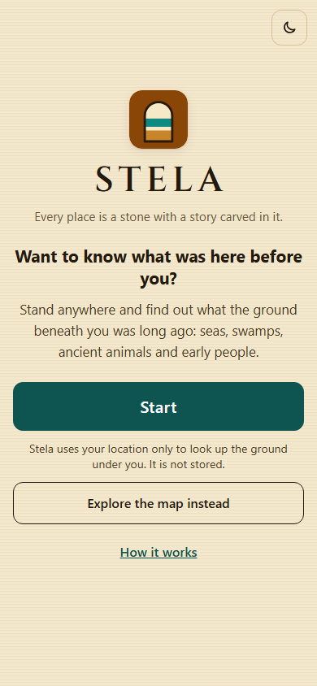

# Stela

> Every place is a stone with a story carved in it.

**Links**

- Live demo: https://stela-0oz5.onrender.com/ (placeholder: replace with the real Render URL)
- Demo video: https://youtube.com/shorts/qN13-StkjzA?si=Na2rDM00hBfKPCYL (placeholder: replace after uploading)
- DEV post: https://dev.to/redwan_niloy_f5f612e7196a/stela-stand-anywhere-and-hear-what-the-ground-under-you-was-long-ago-882
- Repo: https://github.com/RedwanNiloy/Stela

Built October YOUR- 8 to 11, 2026 for the Hacktoberfest Open-Source AI Challenge, Week 1.

Open Stela on your phone, tap **Start** (or drop a pin on the map), and put the phone away. A calm "stone scribe" tells you about the ground under your feet: the rock and its age, what the place probably was (sea, land, swamp), the fossils found nearby, rare animal records nearby, and human history close by. It can read the story aloud.

Built for the Hacktoberfest Open-Source AI Challenge, Week 1 "Touch Grass".



## The one rule

**Code collects facts from open datasets. The open-weight LLM may only narrate those facts.**
The model never looks anything up. If a source is empty, the story says "nothing recorded nearby". If a source is down, the story says it could not be checked. If the model itself is down or too slow, you get the same facts as a plain text summary (`mode: "facts-only"`), never an error screen.

## The start screen

Visitors first see a full-screen intro (wordmark, tagline, a short hook, a large **Start** button), not the map.

- **Start** asks the browser for your location, and only then. The buttons respond to hover, press and keyboard focus (CSS only, no sound, no motion under `prefers-reduced-motion`). Nothing asks for it while the page loads. While the browser's prompt is open the button says "Finding you..."; when a position arrives the results view opens and the lookup runs. If location is denied, unavailable or times out, the map view opens with a friendly message pointing to the pin.
- **Explore the map instead** opens the map with no location request.
- The location promise ("Your location is used for this lookup only. Stela does not store or log it.") is in the **How it works** pop-up, not as a line under the headline.
- **How it works** opens a pop-up message (closes with Escape, a tap outside, or "Got it") with three bullets reusing the About text (open data, an open-weight model that only narrates the facts, location used for the lookup only).
- The header has a **Home** button that returns to the start screen (it also switches Walk mode off, so GPS is not left running). Reloading shows the start screen again.
- Moving from the start screen to the app is a 220 ms fade, skipped under `prefers-reduced-motion`. The theme toggle is on the start screen too. No sound, no autoplay, no large images; tap targets are at least 44 px.
- The flow lives in `static/stela-start.js` (no DOM code), tested in `tests/start.test.js`: creating it and "Explore the map" never request the location, Start requests it once, and a late answer after choosing the map is ignored.

The start screen has a quiet vintage backdrop: aged parchment with a fine double border and thin engraved line art of a pyramid, Anubis and ammonite fossils (a gold-on-dark version in dark mode). The line art is original inline SVG in `static/index.html` and the paper grain is generated in CSS (no image file, no new data source, hidden from screen readers); it stays in the corners so the text is never behind it.

### Try these places

Under the buttons is a one-row slider of six example places (swipe on a phone; previous and next arrows on a wide screen). The start screen is laid out to fit one screen, so it does not need vertical scrolling (checked at 390x844, 360x740, 375x667, 1280x800, 1366x640 and 768x1024). Tapping one opens the map at that place and runs the normal lookup, labelled **Example place**.

- An example is a pin visit that is **not counted**: it never asks for your location, never writes to the passport, never earns an era badge, a rank or an Armchair Explorer badge, and nothing about it is stored. The list is hard-coded in `static/stela-places.js` and written by hand, never by the model; the reasons are general and name no specific fossil. No new data source is used.
- Under the list: "Dense fossil records often reflect where research has been done. A quiet place may be understudied, not empty."
- If the lookup fails, the normal friendly "The stone is quiet right now" message and its **Try again** button appear, and the retry stays an example.

Each place was checked on 2026-10-11 against OpenStreetMap Nominatim and Wikipedia coordinates, then run through the real app (rock, age and the fossil, animal and history sections; the fossil "finds" count is capped at 200 per lookup by the app):

| Place | Coordinates | Rock returned (map scale) | Age (Ma) | Fossil finds |
|---|---|---|---|---|
| Jurassic Coast, Charmouth, UK | 50.738, -2.907 | Lias Group (regional) | 208.5 to 170.3 | 200 (capped) |
| Dover, UK | 51.125, 1.313 | White Chalk Subgroup (regional) | 100.5 to 66 | 200 (capped) |
| Cincinnati region, Ohio, USA | 39.101, -84.513 | Point Pleasant Formation (regional) | 454.5 to 451 | 200 (capped) |
| Hell Creek area, Montana, USA | 47.0, -107.0 | Hell Creek Formation (regional) | 67.5 to 66 | 147 |
| La Brea Tar Pits, Los Angeles, USA | 34.063, -118.356 | Old alluvial-fan deposits (detailed) | 0.78 to 0.01 | 200 (capped) |
| New Orleans, USA | 29.951, -90.072 | Natural Levees (regional) | 0.01 to 0 | 200 (capped) |

Dhaka was tried as the young-ground contrast and replaced: the rock map returns nothing for Dhaka or for any of ten other Bangladeshi towns tried, so the card would have opened an empty lookup. New Orleans gives a real, very young rock instead.

## Icons

An original carved-stone tablet with strata bands (sand, turquoise, ochre) in `static/favicon.svg`. `python tools/make_icons.py` builds `favicon-32.png`, `favicon-48.png`, `favicon.ico` (16/32/48), and the full-bleed `apple-touch-icon.png` (180), `icon-192.png` and `icon-512.png` for `manifest.webmanifest`. It rasterises the SVG with headless Edge/Chrome and packs the files with Pillow (`pip install pillow`); cairosvg was not used because it needs the native Cairo library. The static folder is served as-is, so `/favicon.ico` and the rest need no extra Render setup.

## How it works

```
browser ──/api/where──▶  geo.py: Macrostrat + GBIF + Wikipedia, in parallel (about 1-2 s)
   │                      narrate.py: LLM tells the story from those facts
   └──/api/fossils──▶   geo.py: Paleobiology Database (slow, 3-30 s), then a short LLM paragraph
```

The page shows the fast results immediately and fills in the fossils card when the slow source answers.

### Scope: how far from you do the facts really come from?

Every layer reports a `scope` (`exact_area`, `wider_area`, `nearest_place`, `region` or `none`) with a distance or place name and a plain-words note. Each card on the page shows it, and the narrator must repeat it and never claim wider-area facts happened at your exact spot. Each ladder is capped, and a wider step only runs when the narrower one found nothing relevant:

| Layer | Steps (stops at the first that finds something) |
|---|---|
| Rock | Macrostrat map scale: large (detailed), medium (regional), small (continental). Reports which scale matched. |
| Fossils | same-age finds within about 55 km, then about 222 km, then about 222 km with the age match dropped, then same-age finds anywhere in your country (PBDB `cc` parameter). Reports the real distance to the nearest find. |
| Rare animal records | records within about 30 km, then one wider step of about 90 km with fewer species and fewer records inspected. |
| Human history | Wikipedia pages within 10 km that match history keywords, then the nearest city or town (OpenStreetMap Nominatim) and its Wikipedia introduction, or the state/country if that is all there is. |

If every step is empty, the layer says "nothing recorded".

```
app/main.py      FastAPI: /api/where, /api/fossils, /health, serves the page; rate limit; privacy-safe logging
app/geo.py       the data layers (rock, fossils, rare animal records, nearby history) and the picture lookups (fetch_* talks to the API, parse_* is a pure function). No LLM code
app/people.py    People and past civilizations: place hierarchy, Wikipedia history articles, excerpts, traditions
app/narrate.py   grounding rules + LLM call + plain-text fallback
app/cache.py     TTL cache and per-IP rate limiter (in memory)
static/index.html  one mobile-first page, vanilla JS, Leaflet map, no build step
static/stela.css   the look: palette tokens, light/dark, accordion sections, timeline, image boxes
static/stela-logic.js  walk-mode distance rule and the passport (pure logic, tested in Node)
static/stela-sound.js  optional synthesized UI sounds (one play(name) function, easy to remove)
static/stela-badges.js  era badge table, ranks and the localStorage badge book (pure logic, tested in Node)
static/stela-start.js  start-screen flow (when the location is requested), tested in Node
static/stela-places.js  the hand-written "Try these places" list, tested in Node
static/favicon.svg, *.png, favicon.ico, manifest.webmanifest  icons (built by tools/make_icons.py)
tests/           parsing, scope, names, picture and fallback tests on saved real API responses (tests/samples), plus Node tests of the browser logic and sounds
```

## The look

A compact, calm page in original CSS/SVG: a slim sticky header (name, sound and theme buttons), a collapsible map card, a row of summary chips, a short narration with **Read more** and **Listen**, and four accordion sections: **Ground**, **Fossils**, **Rare animal records** and **People and history**. Sandstone and deep brown with a muted turquoise accent; headings use Cinzel from Google Fonts with a system serif fallback.

- **Ground** shows the rock, what the place probably was (with a small original scene drawing) and a "dig down through time" timeline from today, through human history, to when the rock formed. Fossils and people have their own sections.
- **Sections load on their own.** Each has a skeleton while loading, a clear empty state, and a retry button if its source failed; one failing never affects the others. Every scope label and honesty note stays visible.
- **Phone first.** A fixed bottom bar holds **Use my location** and **Listen**. Tap targets are at least 44 px. The page was checked for horizontal overflow at 360, 390, 768 and 1280 px, in light and dark.
- **Light and dark mode** follow your system and can be switched in the header (remembered in your browser only).
- **Motion is optional.** Animations are short; with `prefers-reduced-motion` they are off. Content is never hidden waiting for an animation or a font, and the page works without Leaflet or the web fonts.
- **Light on the wire.** The only images are small pictures (species photos, history lead images, fossil illustrations) loaded lazily from Wikimedia and PhyloPic; the page itself is one HTML file, one CSS file and two small JS files, plus Leaflet from a CDN. The server gzips responses.
- **Accessibility.** A Lighthouse run on a result page scored 100 for accessibility (mobile and desktop) at the time of the redesign. It has not been re-run since pictures and sounds were added.

## People and past civilizations

A card with what Wikipedia says about the early history of your place at up to five scopes: **your area, city, district, region, country**. It replaces the old "Human history nearby" card; the nearby history pages are still used by the narration.

How it works (`app/people.py`, endpoints `/api/people` for the excerpts and `/api/people/story` for the scribe's paragraph):

1. **Place hierarchy.** One OpenStreetMap Nominatim reverse lookup (zoom 18, English names) gives the `address`: neighbourhood/quarter/suburb, city/town, county/state_district, state, country. (Same 1 request/second limit, User-Agent and cache as the other geocoding.)
2. **Articles.** For each level it looks for the English Wikipedia article "History of <place>"; if there is none it uses the place's own article (for example "Madison, Wisconsin", reached through a redirect). Disambiguation pages are never used, and an article that could be a homonym ("Tower Hamlets" is both a Dover suburb and a London borough) is accepted only if its title names the parent place or its text mentions it.
3. **Excerpts.** With the MediaWiki API it reads the article's introduction and its **earliest-period section** (the first real section of a "History of" article, or the first subsection of "History" in a place's own article). At most 2 sentences of the introduction and 3 of the early section are shown, each with the article title, link, scope label and the Wikipedia CC BY-SA 4.0 credit.
4. **Traditions.** Sentences containing explicit folklore words (legend, myth, folklore, "according to tradition", "is said to"...) are kept out of the excerpts and listed separately as "tradition, not verified history". Nothing is guessed: a sentence without those words is never classed as folklore.
5. **Narration.** The model may use only the supplied excerpts. The prompt requires attribution ("According to Wikipedia"), says which scope each fact belongs to, forbids adding peoples, kingdoms, rulers, dates or origins, forbids claiming an event happened at your exact spot unless the scope is "your area", and says to answer "no early history recorded for this area." when nothing was found (in that case the model is not called at all). A code check also discards a story that names a people, ruler or date that is not in the excerpts, writes "here" for a wider place, or leaves out the attribution, and shows the plain attributed excerpts instead.

The card always says "Histories of this area may be contested or incomplete." No indigenous-territory dataset or any other new source was added.

## Local animal names

Under each rare-animal record the card shows the scientific name always, and a common name only when a source returned one.

- **The call.** For each species (up to 8, in parallel, 4 s timeout, cached by GBIF species key for a day) Stela asks GBIF `GET api.gbif.org/v1/species/{speciesKey}/vernacularNames?limit=300`. Each result has `vernacularName`, `language` (ISO 639-3, for example `eng`, `ben`; sometimes empty), `source` (the dataset it came from), sometimes `preferred`, and no country. The species key and country come from the occurrence records the app already fetches.
- **Which names.** In this order: the browser's language (sent as `lang`, only used for this), then the main language of the record's country (a short built-in table), then English. At most 2 names per species; within a language the IUCN Red List and Catalogue of Life come first. Names with no language code are never shown.
- **Labelling.** For example "English name: Common Rabbit (GBIF · Catalogue of Life)" or "Bengali name: ... (GBIF · <dataset>)". Names are never translated, guessed or written by the model: the model sees only the supplied names, and a code check discards a story that introduces a name ("also known as...") that was not supplied.
- **If a lookup fails or returns nothing,** the species keeps its scientific name only, and the rest of the card is unaffected.
- **Fossils are not covered.** PBDB's `nm2` common-name field was checked: it is English only, empty for most taxa (for example Cephalopoda, *Schloenbachia*, *Gavelinella* have none) and loose where present (Bivalvia gives "clam"), so it is not used.

## Species photos

Each rare animal record has a small photo of the species (about 120 px wide), or a plain silhouette when no photo can be shown with a credit.

- **Where the photo comes from.** For each species (up to 8, two API calls in total, cached by scientific name for a day): `GET en.wikipedia.org/w/api.php?action=query&prop=pageimages&piprop=thumbnail|name&pithumbsize=240&redirects=1&titles=<scientific names>` returns the image on the species' Wikipedia page (`pageimage` file name, `thumbnail.source/width/height`). Then `GET commons.wikimedia.org/w/api.php?action=query&prop=imageinfo&iiprop=extmetadata|url&titles=File:<name>` returns `extmetadata.LicenseShortName`, `LicenseUrl`, `Artist` and `descriptionurl` (the file page). GBIF occurrence photos are deliberately not used: they show the individual record, which can be a dead animal at a market.
- **When a photo is shown.** Only if it has an author and a licence that allows display with credit (CC BY, CC BY-SA, CC0, public domain, GFDL). Non-commercial (NC), no-derivatives (ND), non-free and unknown licences are never shown. If Commons gives no author, or only "unknown", the silhouette is shown instead.
- **Credit.** Next to each photo: "Photo: author · licence", linked to the photo's Commons file page. Beside the list: "Photos show the species in general, not the animal recorded nearby."
- **If anything fails** (lookup error, no image, no licence, the image itself does not load) the entry keeps its silhouette in the same fixed-size box. Photos load lazily, never delay the card, and the page does not shift.
- **The narrator never sees the photos** and is not asked to describe them.
- **Real results (checked).** Dover: all 8 species have a licensed photo. Madison: all 8. Dhaka: 7 of 8; *Glaucostegus younholeei* has no image on Wikipedia.

## Pictures on the other cards

The same rules apply everywhere: a picture is shown only with an author and a licence that allows display with credit (CC BY, CC BY-SA, CC0, public domain, GFDL; never NC, ND or non-free), the credit links to the picture's own page, thumbnails are 120 x 90 px with fixed dimensions, `loading="lazy"` and alt text, and otherwise (or if the image fails to load) a plain original SVG placeholder keeps the same box. Lookups are cached for a day, run after the text is ready, and a failed lookup never delays or breaks a card (that answer is simply not kept, so the next visit retries). The narrator never sees, chooses or mentions pictures.

- **People and history.** The lead image of each Wikipedia article used: the same MediaWiki call that fetches the excerpt also asks `prop=pageimages` (`piprop=thumbnail|name`), then one Commons call returns licence, author and file page for all of them. Note on the card: "Images show the place in general, not your exact spot." Lead images are often maps, flags or coats of arms. Checked: Dover 3 of 4 excerpts have a licensed image (History of Dover has none), Dhaka 4 of 5, Madison 3 of 4.
- **Fossils.** For each fossil group shown (at most 6) the picture comes from [PhyloPic](https://www.phylopic.org): `GET api.phylopic.org/nodes?build=N&filter_name=<name>` (the build number comes from `GET /`), then `GET /nodes/<uuid>?embed_primaryImage=true`, which gives `attribution`, the licence URL, the image page and the 128 px thumbnail. If PhyloPic has no exact-name match, no picture, no author, or a licence that is not allowed (for example Gastropoda's is CC BY-NC-SA), the group's Wikipedia/Commons page image is tried under the same rules. A PhyloPic picture often shows one member of the group (Cephalopoda shows *Cassinoceras*), so the caption names it ("Drawing of Cassinoceras") and says nothing about how the animal looked beyond that. Note: "Illustrations show the animal group, not a fossil found near you."
- **What this place probably was.** An original inline SVG scene (sea floor, swamp, dry salt flats, river and floodplain, volcanic land) drawn for Stela and chosen from the inferred setting type. No photos. If the setting is unknown there is no picture.
- **Rock.** No photos; only a small original strata icon.

## Sound effects

Optional and off by default. A speaker button in the header turns them on; the choice is remembered in your browser (and the page works the same if storage is blocked). The sounds are synthesized in your browser with the Web Audio API (oscillators and filtered noise): there are no audio files and no libraries, and nothing is sent anywhere. They are a soft stone tap on buttons and sections, a short low chime when results arrive, a quiet low tone for empty or error states, and a two-note sound for "Era unlocked". Each is under 0.5 s and quiet. Audio starts only after your first tap, never while the Listen voice is speaking, and never as the only feedback: each sound goes with a visible change. All of it lives in `static/stela-sound.js`, so it is easy to remove.

## The side panel

Walk mode, the Passport and My badges live in a side panel opened from the menu button in the header (a dot on the button shows Walk mode is on), so they do not push the results down the page. It closes with the close button, Escape or a tap outside, and Tab stays inside it while open. Turning Walk mode on closes it, and the Walk status, "new rock unit" message and Listen offer stay in the page where they can be seen.

## Era badges and traveler ranks

Each lookup can earn an **era badge** from how old the rock is, and the number of different era badges sets your **rank**. There is a "My badges" view (original inline SVG art; locked badges are greyed out and say which age range unlocks them), the rank is shown at the top of the results, and a card under the summary says what the lookup gave. A new badge gets a splash over the page: the badge pops in with a ring and rays, with its name and rank that stays until you tap **OK** (no sound; under `prefers-reduced-motion` it appears without any animation).

| Badge | The rock's **oldest** age is... | Boundary used |
|---|---|---|
| Fresh Ground Walker | up to 0.0117 Ma (about 12 thousand years) | base of the Holocene |
| Ice Age Wanderer | up to 2.58 Ma | base of the Quaternary |
| Mammal Age Explorer | up to 66.0 Ma | base of the Cenozoic (Paleogene) |
| Dino Era Traveler | up to 251.902 Ma | base of the Mesozoic (Triassic) |
| Ancient Seas Voyager | up to 538.8 Ma | base of the Phanerozoic (Cambrian) |
| Deep Time Pioneer | over 538.8 Ma | |

The boundaries are in one table (`ERA_BADGES` and `BOUNDARY_MA` in `static/stela-badges.js`) and come from the International Commission on Stratigraphy's International Chronostratigraphic Chart, v2024/12 ([stratigraphy.org/chart](https://stratigraphy.org/chart)); the ICS revises them from time to time. A rock whose oldest age is exactly on a boundary gets the younger badge. If the rock has no mapped age, nothing is awarded.

| Rank | Distinct era badges |
|---|---|
| Noob Pre-Historic Traveler | 1 |
| Fossil Hunter | 2 to 3 |
| Ancient Traveler | 4 to 5 |
| Deep Time Master | 6 |

- **Only your device's location earns era badges.** Start, "Use my location" and Walk mode count. A pin dropped on the map earns only the separate **Armchair Explorer** badge, which never counts toward the rank. A pin is also classified by the rock's age band, with the same six divisions as the era badges (for example "Armchair Explorer: Dino Era" for a pin on Cretaceous chalk; a pin where no rock age is mapped earns plain "Armchair Explorer"). These seven armchair badges are shown separately in My badges and never count toward the rank. After a pin lookup the card also says which era badge the rock would have given, but that is not stored or counted.
- **Honesty on the card.** If the rock's age is a wide range (more than 25 million years between its oldest and youngest age, a Stela choice, not an ICS value) or comes from a regional or continental map scale, the card says so ("Based on regional rock data, so it is less precise.").
- **Privacy.** Badges live only in your browser's localStorage and are never sent to the server. For each badge Stela stores only the era name, the rock name, the date and a coarse place label (latitude and longitude rounded to one decimal, about 11 km), never exact coordinates. If storage is blocked everything still works and the view says the badges only last for this visit. "Clear my badges" (two taps) removes them. Note: "Badges are based on the rock's mapped age range and are stored only in this browser."
- This is separate from the Passport below, which keeps its own list (rounded to about 110 m) in your browser.

## Passport and Walk mode

**Passport.** Every lookup is stamped in a passport: your real location (the "Use my location" button, Start or Walk mode) and pins dropped on the map. Each stamp keeps rounded coordinates (3 decimals), rock name, rock age range, era, the date, and whether it was your location or a pin (the list says which). A spot with no mapped rock is stamped too, as "No rock mapped" (it is filled in if a later lookup there finds a rock); those stamps do not count as an era. The Passport view shows the **oldest ground you have looked up** (the rock that began forming longest ago, by its start age), lists your places, counts the distinct eras you have collected, and "Clear my passport" (two taps) wipes it. A pin is not a visit: the oldest ground is what you looked up, not where you have been. **The passport lives only in your browser (localStorage) and is never sent to the server.** There are no accounts. If your browser blocks storage, the app works as normal and the passport only lasts until you close the page (it tells you so).

**Walk mode.** A toggle that uses `watchPosition` (never a timer). It asks for a new story only when you have moved more than about 300 m from the last request, ignores GPS fixes less accurate than 200 m, and stops watching when you switch it off or the page is hidden (it resumes when the page is visible again). A small "You have moved into a new rock unit" message appears only when the rock unit or era really changed. It never speaks on its own: you either tick "Read each new story aloud automatically" or tap the offered Listen button. It reuses the normal `/api/where` and `/api/fossils` calls, so the server cache and rate limit apply as usual. **Walk mode keeps GPS on and uses more battery.**

## Where it is most useful

Stela is a quick, plain-language first look at the ground under a place. It is most useful where there is something to look at and the open data is good enough to say something:

- **Geoparks and fossil coasts**, where the rock is exposed and many fossils have been recorded: the example places above are of this kind.
- **School trips and field days**: a class can look up the ground at the site beforehand, or on the spot, and see the age of the rock and which kinds of fossils have been recorded nearby.
- **Hikers and walkers**: Walk mode (optional, off by default) updates the story as you cross from one mapped rock unit into another.
- **Curious travellers**: any place with a published geological map, including cities built on very young ground.

Limits to keep in mind: the rock map is often regional rather than detailed (each lookup says which), some places have no mapped rock at all (Bangladesh returned none in the checks above), and fossil records are denser where researchers have worked. A quiet result may mean the place is understudied, not that nothing was there.

## Run it locally

```bash
python -m venv .venv && .venv\Scripts\activate      # macOS/Linux: source .venv/bin/activate
pip install -r requirements.txt
```

### Online mode (any OpenAI-compatible endpoint serving an open-weight model)

```bash
cp .env.example .env     # then fill in the three values; or just export them
export LLM_BASE_URL=https://your-provider.example/v1
export LLM_API_KEY=...
export LLM_MODEL=<the open-weight Gemma model name your provider uses>
uvicorn app.main:app --port 8000 --no-access-log
```

Open http://localhost:8000. Stela calls `POST {LLM_BASE_URL}/chat/completions`. The model name is never hard-coded.

### Offline mode (local Ollama)

Leave `LLM_BASE_URL` empty and run Ollama:

```bash
ollama pull gemma3:4b
export OLLAMA_MODEL=gemma3:4b        # default; use any model you have pulled
uvicorn app.main:app --port 8000 --no-access-log
```

On a slow CPU a local reply can take longer than the 30 s limit, and Stela then falls back to the facts-only summary. To wait longer while testing, set `LLM_TIMEOUT=120`.

> Always start uvicorn with `--no-access-log`. Its access log prints full URLs, which contain coordinates.

### Tests

```bash
python -m pytest -q          # no network needed (also runs the browser-logic tests if Node.js is installed)
node --test tests/*.test.js   # the browser-logic tests on their own: walk-mode distance rule, passport storage, sound rules, badges, start flow, example places
python tests/capture_samples.py   # optional: re-record the sample API responses (also capture_people.py, capture_phylopic.py; Wikipedia rate-limits bursts, so run them one place at a time)
```

## Environment variables

| Name | Meaning |
|---|---|
| `LLM_BASE_URL` | OpenAI-compatible base URL (ending in `/v1`). Empty means use local Ollama. |
| `LLM_API_KEY` | Bearer token for that endpoint. Never commit it. |
| `LLM_MODEL` | Model name your endpoint expects. |
| `OLLAMA_URL` / `OLLAMA_MODEL` | Offline mode only. Default `http://localhost:11434` and `gemma3:4b`. |
| `LLM_TIMEOUT` | Seconds before the LLM call is abandoned. Default 30. |
| `STELA_CONTACT` | A URL or email added to the User-Agent of outgoing data requests. Nominatim's policy requires an identifying User-Agent, and Wikimedia rate-limits anonymous ones harder. Set it when you deploy. |

## Deploy on Render (free tier)

1. Push this repo to GitHub.
2. In Render: **New, Blueprint**, pick the repo. `render.yaml` sets up a Python web service with a health check on `/health`.
3. Fill in `LLM_BASE_URL`, `LLM_API_KEY`, `LLM_MODEL` (and `STELA_CONTACT`) in the service's Environment tab (they are marked `sync: false`, so they are never in the repo).
4. Deploy. The free tier sleeps when idle, so the first request after a pause is slow.

## Privacy

Stela does not store or log your location or IP address. Your browser's language tag (for example `bn-BD`) is sent with each lookup only to choose which animal names to show; it is not stored or logged. Pictures (species photos, history lead images, fossil illustrations) are loaded by your browser directly from Wikimedia's servers (`thumb.wikimedia.org`) and PhyloPic's (`images.phylopic.org`), so those services can see your IP address, as for any image on the web. The requests carry no referrer. Stela does not proxy the photos; a proxy would hide your IP from Wikimedia but make our server fetch, hold and serve images (more bandwidth, a cache to run, and a new thing that can break), so it is a choice for the project owner. The passport and your era badges are stored only in your own browser and are never sent to the server (badges keep only the era, rock name, date and a place rounded to about 11 km). In Walk mode your position is sent to the server like any other lookup, but only when you have moved about 300 m. Logs contain only the route, status, timing and error types. Coordinates are rounded to 3 decimals (about 110 m) for the in-memory cache, which is lost on restart. The rate limiter keeps IPs in memory only. Your coordinates are sent to Macrostrat, PBDB, GBIF and Wikipedia to fetch the facts, as part of the request URL. They are also sent to a geocoding service, [OpenStreetMap Nominatim](https://operations.osmfoundation.org/policies/nominatim/): always for "People and past civilizations" (to get your place hierarchy: neighbourhood, city, district, region, country), and when nothing is recorded within 10 km for the nearest named place (and, for fossils, your country). Wikipedia then receives only the place names that came back (for example "Dover" or "Kent"), not your coordinates, but those names are of course close to where you are. That is one extra third party, only in that case. Stela spaces those requests to at most one per second, and caches the result in memory by rounded coordinates.

## Data sources and licenses

| Source | Used for | License |
|---|---|---|
| [Macrostrat](https://macrostrat.org) | rock unit, age | CC-BY 4.0 |
| [Paleobiology Database](https://paleobiodb.org) | fossil finds | CC-BY 4.0 |
| [GBIF](https://www.gbif.org) with IUCN Red List categories | rare animal records | CC0 / CC-BY per dataset |
| [Wikipedia](https://en.wikipedia.org) / MediaWiki API | nearby history pages; history excerpts for "People and past civilizations" | text under [CC BY-SA 4.0](https://creativecommons.org/licenses/by-sa/4.0/): excerpts are shortened and attributed on the page, with links to the article and its authors |
| [Wikimedia Commons](https://commons.wikimedia.org) | licence, author and file page of each species photo (the picture itself is the species' Wikipedia page image) | per photo: CC BY, CC BY-SA, CC0, public domain or GFDL only; credited and linked beside each photo |
| [PhyloPic](https://www.phylopic.org) | fossil group illustrations | per image: CC0, public domain, CC BY or CC BY-SA only; author and licence shown beside each one |
| [OpenStreetMap Nominatim](https://nominatim.org) | place hierarchy (neighbourhood to country), nearest city/town and country | ODbL |
| [OpenStreetMap](https://www.openstreetmap.org/copyright) tiles, [Leaflet](https://leafletjs.com) | map | ODbL, BSD-2 |

Please check each provider's current terms before heavy use. All artwork is original CSS/SVG.

## Honest limitations

- **Fossils show what has been found, not everything that lived there.** Many places have few or no records.
- **Sea, land or swamp is a guess from the rock type**, using a short keyword list. Sandstone in particular can be either.
- **Rock maps vary in detail.** The unit shown is the best match at the map scale available, and ages are ranges. When only a regional or continental map exists, the card says the rock name is a broader grouping.
- **Rare-animal records are not proof an animal lives nearby.** A GBIF record says where an animal was recorded. It can be a dead animal, a market or fish-landing find, a museum specimen, or a misplaced location. In Dhaka, the results were mostly marine sharks and rays, with some records marked dead. Stela therefore says "recorded nearby", never "alive" or "lives here".
- **Species photos are of the species, not the animal.** They come from the species' Wikipedia page, so they are often of a different individual in a different place (sometimes of another subspecies or sex), and a photo may be missing because the page has none or the licence does not allow display. Scientific names that Wikipedia does not know give no photo. Photos are shown only with credit.
- **Picture lookups are the first thing Wikimedia's rate limit hits.** Loading one place fires several Wikipedia and Commons requests at once, and an anonymous client that exceeds the limit gets HTTP 429 with a `Retry-After` of about 45 s. Picture lookups are spaced 0.5 s apart, retried only when the pause is short, and then give up: you see placeholders and the next visit tries again. Set `STELA_CONTACT` in production, which Wikimedia asks for. In testing from a development machine this happened regularly after many lookups in a row.
- **Fossil and history pictures are generic.** A fossil group's illustration is a member of the group (often a living species or one genus), and a history article's lead image is whatever the editors chose: it may be a map, a flag or a skyline of the wider place.
- **Condition is only shown when the record says so.** It reads GBIF's `vitality` field and `basisOfRecord` (specimen or sample). Most records leave `vitality` empty, so most entries say "do not say". Free-text remarks are not interpreted, and nothing is guessed. The check covers up to 50 records per species.
- **Records may include introduced or feral animals** (rabbits and feral horses show up), because GBIF does not say which records are native. Counts are numbers of records, not of animals.
- **Human history is whatever has a Wikipedia page within 10 km** and matches a list of history keywords. If there is none, the card shows a general introduction to the nearest city (or state), clearly labelled as not your exact spot. That is not the history of your spot, and it is not keyword-checked.
- **Wider-scope facts are about somewhere else.** Fossils can come from 100+ km away or from anywhere in your country (then no distance is given, because the country step returns an arbitrary sample, not the nearest finds). Rare-animal records can come from up to about 90 km away. The cards and the narration say so, but the distance in the fossil note is to the nearest find among the (at most 200) records returned.
- **Search areas are boxes, not circles** for fossils, so a find at a box corner can be a little farther than the stated size.
- **The geocoder can be wrong or empty.** Nominatim returns nothing over open water, and its Wikipedia tag sometimes points to a district page rather than the town itself (for example "Dover District").
- **"People and past civilizations" makes about 8-13 Wikipedia requests per new place** (cached afterwards). Wikipedia answered some of them with HTTP 429 during testing from one IP with an anonymous User-Agent. Stela limits itself to 3 requests at once, spaces them out, and when some fail it shows what it has with a note ("Some Wikipedia lookups failed just now...") and does not cache the incomplete result. Setting `STELA_CONTACT` matters here.
- **Matching a place to an article can still go wrong.** Place names are ambiguous and Wikipedia has no exact "this place" lookup from Nominatim's hierarchy. Disambiguation pages and homonyms are rejected as described above, but a wrong or missing article is possible, especially for neighbourhoods, which are skipped when no confident match exists.
- **"Earliest period" is a heuristic.** It is the first real section of a "History of" article (which are chronological) or the first subsection of "History". The excerpt is only the first 2-3 sentences, so it can start mid-story or be dry.
- **Only English Wikipedia and English place names**, so places whose history is mostly documented in other languages show little or nothing.
- **Histories are contested and incomplete.** Wikipedia reflects what its editors have written, often from one tradition or perspective, and indigenous and pre-colonial history is frequently thin or missing. The card says so, and no indigenous-territory dataset is used.
- **Folklore detection is by explicit words only**, so legends told without those words appear as ordinary text, and a sentence that merely contains the word "legend" (a hotel name, a film) is listed as a tradition.
- **A small language model can still blend or paraphrase the excerpts.** In testing it once joined a Wisconsin fact and a United States fact into one sentence, and once wrote "here" for a wider place. The prompt now forbids both and the code check catches "here" and invented peoples, rulers and dates, but it cannot catch every paraphrase. The excerpts are always shown next to the story, so check them.
- **Wikipedia may rate-limit (HTTP 429)**, especially for anonymous or shared-IP clients. The card then says it could not be checked. Setting `STELA_CONTACT` helps.
- **Small language models can slip.** Strict prompts reduce invented details but cannot guarantee zero. In testing, a 4B local model sometimes turned scientific names into common names, and once said rare animals "wander" the area. A code check now discards any story that calls the animals alive or living here and shows the plain facts instead. That is why the plain fact cards are always shown under the story.
- PBDB can take 30 seconds or more for sparse regions.
- **A one-line summary is the first sentence of the introduction**, which Wikipedia sometimes cuts short (for example after "St.").
- **The passport is per browser and per device.** Clearing site data, using a private window, or switching phones starts a new one. There is no sync, by design.
- **Walk mode needs the page open and visible.** Browsers pause GPS for hidden pages and locked screens, so it cannot track you in the background. GPS can be slow or inaccurate indoors, under tree cover and in cities; weak fixes are ignored rather than guessed from.
- **"New rock unit" is best effort.** Names differ between map scales for the same ground, so a change of unit is only reported when both lookups used the same map scale; a change of era (time interval) is always reported. Geological maps are coarse, so boundaries you walk across may not match what is on the ground.
- **Walk mode and the rate limit.** Each new story is four requests (where, fossils, people, people/story; about 20 stories a minute are allowed). If the server says slow down, Walk mode pauses for a minute.

- **Local names are incomplete and sometimes wrong.** GBIF aggregates many datasets, some of which label names with the wrong language (a Spanish name tagged English, for example), and many species have no name in the language you read. In testing, none of Dhaka's eight rare species had a single Bengali, Hindi or Urdu name, so Dhaka shows English names or only scientific names. The card says "Local names come from GBIF and may be incomplete." The country's main language is a rough short list, and countries not on it are skipped.
## Out of scope for v1

Not in this version: sky and star views, AR/VR, 3D models, accounts or sign-in, a server-side database, a time slider, and storing your location on the server. The passport and badges exist, but they live only in your browser (see "Passport and Walk mode"). Pictures of animals are shown (species photos and fossil group illustrations, each credited), as flat images, not 3D.

## License

Stela's code is released under the [MIT License](LICENSE). The data it shows keeps its own licences, credited in the app and in the sources list above (for example Wikipedia text is CC BY-SA 4.0 and each photo has its own licence).
